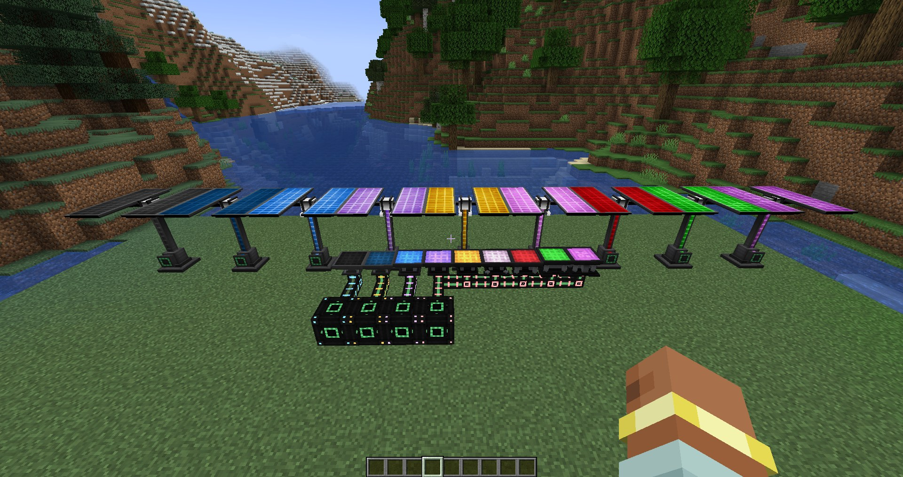

<p align="center">
  
</p>

<h1 align="center">Mekanism Advanced Generators</h1>

<p align="center">
  <b>Solar power for the whole Mekanism journey</b> - nine tiers of solar panels, big 3x3 solar generators, and energy cubes and universal cables that go far beyond Ultimate.
</p>

<p align="center">
  <a href="https://www.curseforge.com/minecraft/mc-mods/mekanism-advancedgenerators"></a>
  <a href="https://www.minecraft.net"></a>
  <a href="https://neoforged.net"></a>
  <a href="https://www.curseforge.com/minecraft/mc-mods/mekanism"></a>
  <a href="LICENSE"></a>
</p>

<p align="center">
  
</p>

## Features

- ☀️ **Nine solar panel tiers** - Advanced, Hybrid, Ultimate Hybrid, Quantum, Spectral, Singular, Light Absorbing,
  Photonic and Creative, from 150 J/t up to 10 MJ/t, each tier three times the one before.
- 🏗️ **Big solar generators** - a 3x3 panel on a pole, like Mekanism's Advanced Solar Generator, in all nine tiers:
  six times a panel of the same tier, and they heat a Thermal Evaporation Plant.
- 🌦️ **Real Mekanism solar rules** - more power in hot, dry biomes, less in the rain, nothing under a roof or at night.
- 🔋 **Energy cubes past Ultimate** - Cosmic, Supreme, Infinity and Galactic, up to 1,048,576 GJ, with Mekanism's side
  configuration, energy core and charge slots.
- ⚡ **Universal cables past Ultimate** - four glowing tiers up to 33,554,432 MJ/t that join Mekanism's energy networks.
- 📱 **Energy tablets** - seven bigger tablets to charge your gear and craft the higher tiers.
- 🔇 **Mekanism through and through** - Mekanism's GUIs, security, redstone control, comparators, configuration cards
  and the muffling upgrade.
- ⚙️ **Every number configurable** - generation, buffers, cube capacity and output, cable capacity, tablet energy.

| Tier | Solar panel | Big solar generator |
|---|---|---|
| Advanced | 150 J/t, 288 kJ | 900 J/t, 1.73 MJ |
| Hybrid | 450 J/t, 864 kJ | 2,700 J/t, 5.18 MJ |
| Ultimate (Hybrid) | 1,350 J/t, 2.59 MJ | 8,100 J/t, 15.6 MJ |
| Quantum | 4,050 J/t, 7.78 MJ | 24,300 J/t, 46.7 MJ |
| Spectral | 12,150 J/t, 23.3 MJ | 72,900 J/t, 140 MJ |
| Singular | 36,450 J/t, 70.0 MJ | 218,700 J/t, 420 MJ |
| Light Absorbing | 109,350 J/t, 210 MJ | 656,100 J/t, 1.26 GJ |
| Photonic | 328,050 J/t, 630 MJ | 1,968,300 J/t, 3.78 GJ |
| Creative | 10,000,000 J/t, 2 GJ | 60,000,000 J/t, 12 GJ |

Peak generation at noon in a temperate biome and the energy buffer; the output rate is twice the peak.

| Tier | Energy cube | Universal cable |
|---|---|---|
| Cosmic | 2,048 GJ, 4.10 MJ/t out | 65,536 MJ/t |
| Supreme | 16,384 GJ, 32.8 MJ/t out | 524,288 MJ/t |
| Infinity | 131,072 GJ, 262 MJ/t out | 4,194,304 MJ/t |
| Galactic | 1,048,576 GJ, 2.10 GJ/t out | 33,554,432 MJ/t |

## Compatibility

[](https://www.curseforge.com/minecraft/mc-mods/mekanism) ✅ **[Mekanism](https://www.curseforge.com/minecraft/mc-mods/mekanism)** (required) - cubes, cables and machines work with everything Mekanism has.

[](https://www.curseforge.com/minecraft/mc-mods/mekanism-generators) ✅ **[Mekanism Generators](https://www.curseforge.com/minecraft/mc-mods/mekanism-generators)** (required) - the Solar Generator starts the panel line.

[](https://www.curseforge.com/minecraft/mc-mods/jade) ✅ **[Jade](https://www.curseforge.com/minecraft/mc-mods/jade)** (optional) - shows the stored energy, the current production and whether a panel sees the sun.

[](https://www.curseforge.com/minecraft/mc-mods/jei) ✅ **[JEI](https://www.curseforge.com/minecraft/mc-mods/jei)** (optional) - every recipe.

## Controls

No key bindings. Panels and generators open Mekanism-style screens with the stored energy, the current production,
the output rate and a sun indicator. Mekanism's details and description keys work on every item tooltip.

## Crafting

Solar elements (black glass, lapis dust and enriched materials) and control circuits turn Mekanism's Solar Generator
into the Advanced Solar Panel, each panel into the next tier, and four panels into a big generator (shapeless crafting
gives them back). Cubes and cables start from Mekanism's Ultimate ones. All recipes are in
[JEI](https://www.curseforge.com/minecraft/mc-mods/jei).

## Configuration

Server configs (one copy per world in `serverconfig/Mekanism/`, editable in game under Mods > Mekanism Advanced
Generators > Config):

- `mekanismadvancedgenerators.toml`: peak generation of every solar panel and big solar generator.
- `solarpanels-storage.toml`: energy buffers of the solar blocks, energy cube capacity and output rate, cable capacity.
- `solarpanels-gear.toml`: capacity and charge rate of the energy tablets.

## Installation

1. Install [NeoForge](https://neoforged.net) for Minecraft 1.21.1.
2. Install [Mekanism](https://www.curseforge.com/minecraft/mc-mods/mekanism) and
   [Mekanism Generators](https://www.curseforge.com/minecraft/mc-mods/mekanism-generators).
3. Put this mod into the `mods` folder of the client and the server.

Older versions for Minecraft 1.18.2, 1.19.2 and 1.20.1 are on CurseForge; their sources are in the branches of this
repository.

## Building

```sh
./gradlew build
```

The jar is written to `build/libs/`. `./gradlew runGameTestServer` runs the game tests.

## Credits

- Author: **Pocky**.
- Models and textures: **akaleaf**. Help: **Yuik_Link**.
- Chinese translation: [UraraChiya](https://github.com/UraraChiya), [mc-kaishixiaxue](https://github.com/mc-kaishixiaxue).

<!-- more-mods:start -->
## More mods by Pocky

**🌦️ Weather & nature**

<table>
  <tr>
    <td width="56"><a href="https://www.curseforge.com/minecraft/mc-mods/hoarfrost-snow-blizzards"></a></td>
    <td><a href="https://www.curseforge.com/minecraft/mc-mods/hoarfrost-snow-blizzards"><b>Hoarfrost: Snow & Blizzards</b></a> - seven kinds of snowfall, a living wind and soft snow on the land (<a href="https://github.com/Pocky-l/hoarfrost">source</a>)</td>
  </tr>
  <tr>
    <td width="56"><a href="https://www.curseforge.com/minecraft/mc-mods/petrichor-rain-storms"></a></td>
    <td><a href="https://www.curseforge.com/minecraft/mc-mods/petrichor-rain-storms"><b>Petrichor: Rain & Storms</b></a> - realistic rain, puddles, drips and branching lightning (<a href="https://github.com/Pocky-l/petrichor">source</a>)</td>
  </tr>
  <tr>
    <td width="56"><a href="https://www.curseforge.com/minecraft/mc-mods/rustling-leaves"></a></td>
    <td><a href="https://www.curseforge.com/minecraft/mc-mods/rustling-leaves"><b>Rustling Leaves</b></a> - falling leaves and leaf piles you can wade through, rake and blow away (<a href="https://github.com/Pocky-l/rustling-leaves">source</a>)</td>
  </tr>
</table>

**💡 Light**

<table>
  <tr>
    <td width="56"><a href="https://www.curseforge.com/minecraft/mc-mods/lumen-rigs"></a></td>
    <td><a href="https://www.curseforge.com/minecraft/mc-mods/lumen-rigs"><b>Lumen Rigs</b></a> - aimable spotlights and floodlights with colored light and visible beams (<a href="https://github.com/Pocky-l/lumen-rigs">source</a>)</td>
  </tr>
  <tr>
    <td width="56"><a href="https://www.curseforge.com/minecraft/mc-mods/neon-glowsticks"></a></td>
    <td><a href="https://www.curseforge.com/minecraft/mc-mods/neon-glowsticks"><b>Neon Glowsticks</b></a> - throwable glowsticks that bounce, roll and light up the dark (<a href="https://github.com/Pocky-l/neon-glowsticks">source</a>)</td>
  </tr>
</table>

**🎨 Graphics & performance**

<table>
  <tr>
    <td width="56"><a href="https://www.curseforge.com/minecraft/mc-mods/turbo-for-distant-horizons"></a></td>
    <td><a href="https://www.curseforge.com/minecraft/mc-mods/turbo-for-distant-horizons"><b>Turbo for Distant Horizons</b></a> - Distant Horizons terrain generated many times faster (<a href="https://github.com/Pocky-l/dhturbo">source</a>)</td>
  </tr>
  <tr>
    <td width="56"><a href="https://www.curseforge.com/minecraft/mc-mods/pocky-shaders"></a></td>
    <td><a href="https://www.curseforge.com/minecraft/mc-mods/pocky-shaders"><b>Pocky Shaders</b></a> - a cosy, natural shader pack that sets itself up (<a href="https://github.com/Pocky-l/pocky-shaders">source</a>)</td>
  </tr>
</table>

**⚔️ Gear & gameplay**

<table>
  <tr>
    <td width="56"><a href="https://www.curseforge.com/minecraft/mc-mods/holy-staff"></a></td>
    <td><a href="https://www.curseforge.com/minecraft/mc-mods/holy-staff"><b>Holy Staff</b></a> - a healing staff with three skills and flying heal numbers (<a href="https://github.com/Pocky-l/holy-staff">source</a>)</td>
  </tr>
  <tr>
    <td width="56"><a href="https://www.curseforge.com/minecraft/mc-mods/ranchers-vacpack"></a></td>
    <td><a href="https://www.curseforge.com/minecraft/mc-mods/ranchers-vacpack"><b>Rancher's Vacpack</b></a> - a Slime Rancher vacuum gun for items and small mobs (<a href="https://github.com/Pocky-l/ranchers-vacpack">source</a>)</td>
  </tr>
</table>

**🛠️ Server tools**

<table>
  <tr>
    <td width="56"><a href="https://www.curseforge.com/minecraft/mc-mods/inventory-backups"></a></td>
    <td><a href="https://www.curseforge.com/minecraft/mc-mods/inventory-backups"><b>Inventory Backups</b></a> - inventory and ender chest backups with one-click restore for admins (<a href="https://github.com/Pocky-l/inventory-backups">source</a>)</td>
  </tr>
</table>

<!-- more-mods:end -->

## License

[MIT](LICENSE). Free to use in modpacks.
